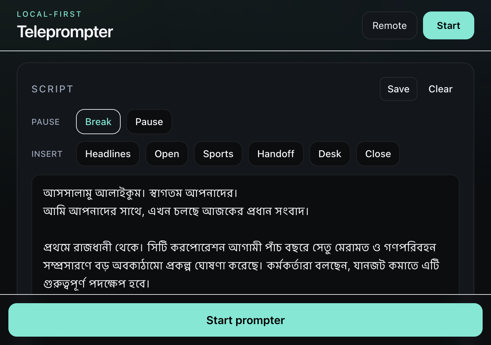
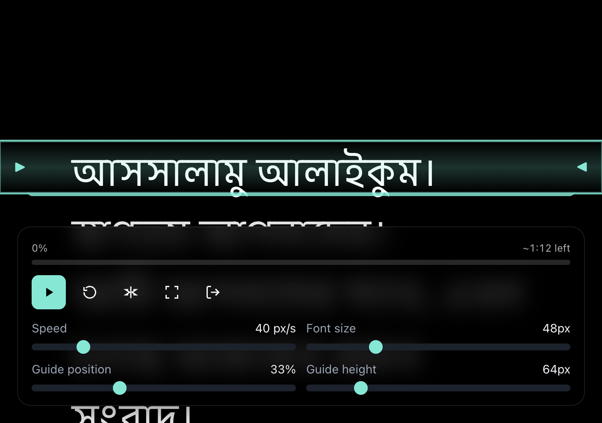
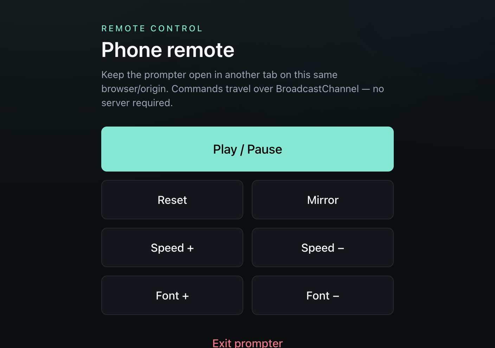

# Teleprompter

A local-first web teleprompter for news anchors, presenters, and creators. Write your script, tune scroll and guide settings, then go full-screen — everything stays in the browser (`localStorage`), with no backend required.

**Live:** [teleprompter.sagardash.me](https://teleprompter.sagardash.me/) · [teleprompter.subarna.me](https://teleprompter.subarna.me/)

Built with **Next.js (App Router)**, **React**, **TypeScript**, and **Tailwind CSS**.  
Brand: [subarna.me](https://subarna.me) · Developed by [Sagar Dash](https://sagardash.me)

## Screenshots

### Editor

Script editor with Bangla news presets, pause tools, and settings.



### Prompter

Full-screen scrolling view with reading guide and floating controls.



### Remote

Same-browser phone remote via BroadcastChannel.



## Features

- Smooth `requestAnimationFrame` auto-scroll with live speed changes
- Play / pause / reset, fullscreen, mirror (horizontal + vertical)
- Font size, line height, side margins, text / background / guide colors
- Adjustable reading guide (drag or sliders)
- 3-2-1 countdown, progress bar, and time remaining
- Pause markup: `---` and `[pause Ns]` (plus insert buttons)
- Bangla news presets and saved scripts
- Keyboard shortcuts on the prompter page
- Optional voice-follow (Web Speech API / Chrome)
- Same-browser remote control (`/remote`)

## Quick start

```bash
npm install
npm run dev
```

Open [http://localhost:3000](http://localhost:3000).

| Route | Purpose |
| --- | --- |
| `/` | Script editor + settings |
| `/prompter` | Full-screen prompter |
| `/remote` | Phone remote (same browser) |

## Keyboard shortcuts (prompter)

| Key | Action |
| --- | --- |
| Space | Play / pause |
| ↑ / ↓ | Speed up / down |
| + / − | Font size |
| M | Toggle mirror |
| F | Fullscreen |
| R | Reset |
| Esc | Exit to editor |

## Deploy (Cloudflare Workers)

Static export → Workers assets.

```bash
# Token in `.env` as CLOUDFLARE_API_TOKEN
npm run deploy
```

Custom domains (see `wrangler.jsonc`):

- `teleprompter.sagardash.me`
- `teleprompter.subarna.me`

If a custom domain returns **522**, run:

```bash
npm run fix:domain
```

## Remote control notes

- **BroadcastChannel** (built-in): `/prompter` + `/remote` on the same origin/browser
- **Cross-device:** use WebSocket or WebRTC with a shared room code (not implemented)

## License

MIT
